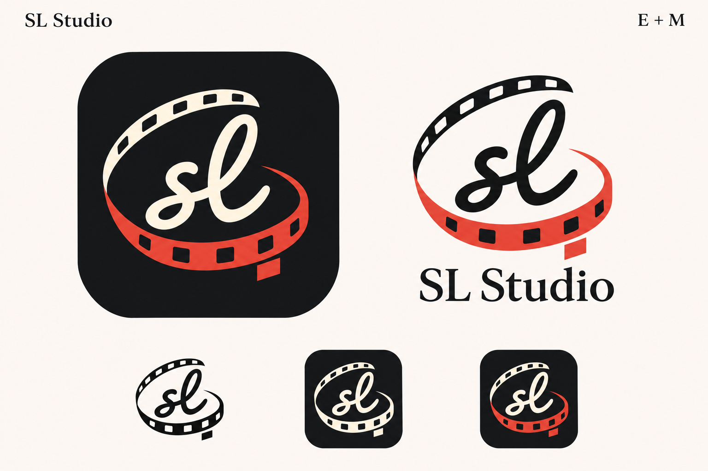

# SL Studio — logo E + M

Hướng thiết kế được chốt tạm ngày 2026-11-09; đã tích hợp theo yêu cầu vào cùng ngày.

- Tên thương hiệu đã chọn: **SL Studio**.
- Chữ biểu tượng: `sl` viết tay liền nét từ mẫu **E**, có vòng chữ l cao.
- Dải phim: vòng elip từ mẫu **M**, phần phía sau màu ngà và phần phía trước màu đỏ.
- Icon: nền than `#151719`, chữ và dải phim phía sau màu ngà `#fff5df`, dải phim phía trước màu đỏ `#e64439`.

## Asset đã xuất

- [Logo giao diện đơn sắc](../packages/assets/logo.svg): nền trong suốt, dùng cho các vị trí logo hiện có, loading, mask và dark mode.
- [Logo màu](../packages/assets/slStudioLogo.svg): nền trong suốt, chữ và dải phim phía sau màu than, dải phim phía trước màu đỏ.
- [Icon màu](../packages/assets/slStudioIcon.svg): nguồn vector có nền than, dùng cho favicon và xuất các kích thước icon.
- [ICO Windows](../packages/assets/logo.ico): 16, 24, 32, 48, 64, 128, 256 px.
- [Iconset](../packages/assets/logo.iconset/): giữ 10 tên file hiện có, từ 16 đến 1024 px; các pipeline macOS, Linux và mobile tiếp tục dùng đường dẫn cũ.
- [Logo dịch vụ Toonflow](../packages/assets/toonflowLogo.svg): giữ nguyên logo gốc cho thẻ model và tài khoản dịch vụ Toonflow.

Master được tách nền bằng ImageGen built-in từ bảng mẫu đã chốt, rồi chuyển thành đường vector và màu phẳng. [Prompt xuất master](slStudioLogoPrompt.txt). Không thêm thư viện hoặc script xuất ảnh vào dependency của dự án.

## Tích hợp và xác minh

- Đã thay nguồn logo dùng chung trong app, favicon màu và hình logo trong animation khởi động native. Timeline, nhịp chuyển động và wordmark hiện có của màn hình khởi động được giữ nguyên.
- Đã xem bản nền sáng, nền tối, đơn sắc và các kích thước icon nhỏ.
- Web typecheck và build thành công; favicon được emit thành asset và URL dev trả HTTP 200.
- Desktop macOS ARM64 build thành công tại `build/desktop/app/stable-macos-arm64/toonflow.app`.
- Iconset được `iconutil` chuyển thành ICNS thành công; ICO có 7 kích thước.
- Đã render trực tiếp logo splash mới qua ThorVG ở pha ready; không khởi động backend hoặc thao tác dữ liệu người dùng.
- Chưa build hoặc chạy lại bản Windows, Linux và mobile trong lần thay logo này; các pipeline đó nhận asset đã cập nhật khi build tiếp.
- Không đổi tên app, package, bundle identifier, cấu hình tài khoản hoặc dữ liệu người dùng.
